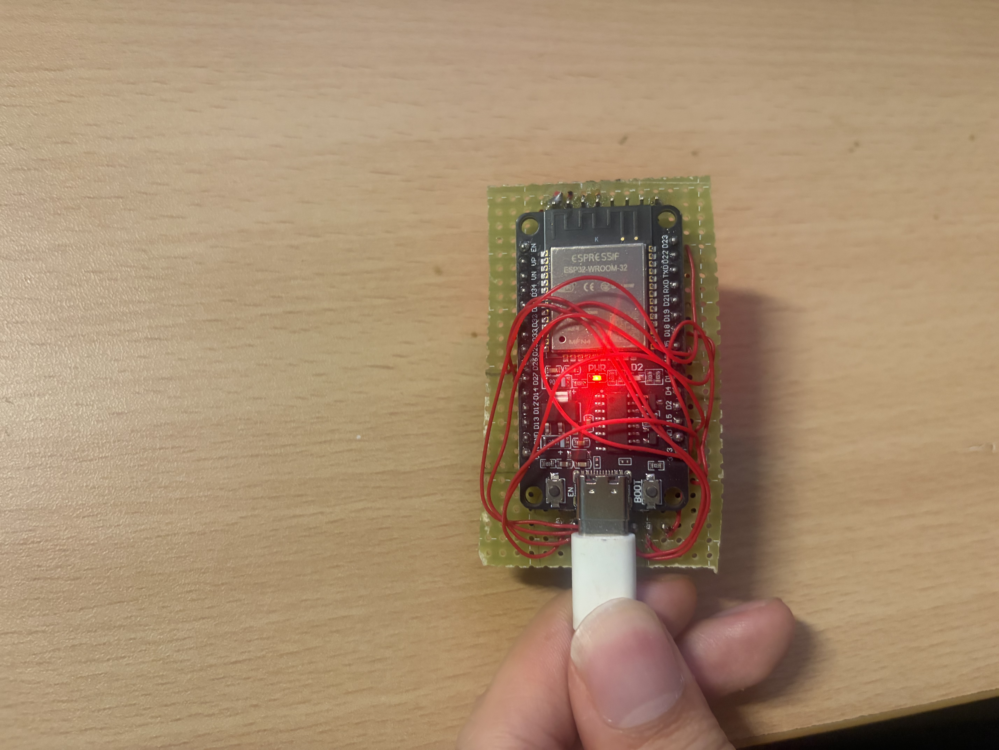
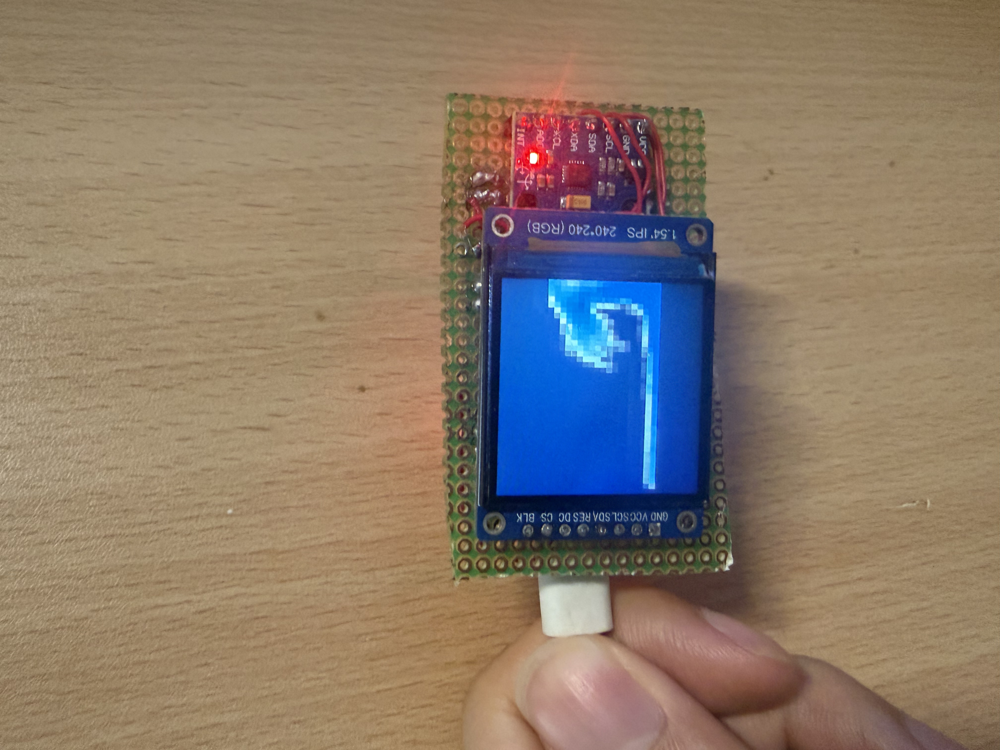

# Sea EDC

一个基于 `ESP32-WROOM-32`、`MPU6050` 和 `ST7789` 彩色屏的小型海洋 EDC 固件实验。

它会在一块小屏幕里渲染像素风格的“瓶中海水”：设备倾斜或晃动时，水体会根据 IMU 读数产生流动、回弹、撞壁和波光效果。当前实现使用粒子 + 网格的轻量水体模型，并针对普通 ESP32 和 240x240 ST7789 屏幕做了简化。

## 实物图





## 项目结构

```text
Sea_EDC/
├─ README.md
├─ LICENSE
└─ sea_edc/
   ├─ sea_edc.ino
   ├─ SeaConfig.h
   ├─ WaterModel.*
   ├─ SurfaceRenderer.*
   ├─ MotionInput.*
   ├─ TankGrid.h
   └─ Droplet.h
```

Arduino 工程在 `sea_edc/` 目录中。克隆仓库后，用 Arduino IDE 打开：

```text
sea_edc/sea_edc.ino
```

## 硬件

当前测试硬件：

- ESP32-WROOM-32 开发板
- MPU6050 / GY-521 六轴 IMU 模块
- 1.54 寸 ST7789 240x240 SPI 彩色 TFT 屏

## 接线

MPU6050:

| MPU6050 | ESP32 |
| --- | --- |
| `VCC` | `3V3` |
| `GND` | `GND` |
| `SCL` | `GPIO22` |
| `SDA` | `GPIO21` |

ST7789:

| ST7789 | ESP32 |
| --- | --- |
| `SCL` / `SCK` | `GPIO18` |
| `SDA` / `MOSI` | `GPIO23` |
| `CS` | `GPIO5` |
| `DC` | `GPIO27` |
| `RES` / `RST` | `GPIO26` |
| `BLK` | `3V3` |
| `VCC` | `3V3` |
| `GND` | `GND` |

如果你的屏幕引脚命名不同，通常可以按 SPI 信号对应：`SCL/SCK` 是时钟，`SDA/MOSI` 是数据。

## Arduino IDE 设置

开发板：

- `ESP32 Dev Module`

需要安装的库：

- `Adafruit GFX Library`
- `Adafruit ST7789 and ST7735 Library`

需要安装的开发板包：

- `esp32 by Espressif Systems`

## 烧录和运行

1. 用 Arduino IDE 打开 `sea_edc/sea_edc.ino`。
2. 选择开发板 `ESP32 Dev Module`。
3. 选择正确的串口。
4. 确认已经安装上面的两个 Adafruit 显示库。
5. 点击上传。

启动后，串口会输出 IMU 状态和帧率信息。如果 MPU6050 没有被识别，固件会使用默认重力方向继续渲染，但晃动反馈不会正常。

## 常见调整

主要参数在 `sea_edc/SeaConfig.h`：

- `kWaterCols` / `kWaterRows`：模拟网格尺寸
- `kPixelW` / `kPixelH`：每个模拟像素块在屏幕上的尺寸
- `kStartDroplets`：初始水量
- `kGravityScale`：重力/晃动反馈强度
- `kGridMix`：粒子速度与网格速度的混合比例
- `kPressurePasses`：压力迭代次数，越高越稳但越吃性能
- `kWallBounce`：撞墙回弹强度
- `kSeaPalette`：水体颜色表
- `kGlint*`：运动时的波光高光参数

显示屏相关引脚在 `sea_edc/sea_edc.ino` 顶部：

```cpp
#define TFT_SCLK 18
#define TFT_MOSI 23
#define TFT_CS 5
#define TFT_DC 27
#define TFT_RST 26
```

如果屏幕颜色反了，可以尝试修改：

```cpp
#define TFT_INVERT true
```

把它改成 `false` 后重新烧录。

## 当前状态

这是一个实验性质的小玩具固件，还在继续调效果。当前版本重点是：

- 在普通 ESP32-WROOM-32 上能跑起来
- 保留比较明显的像素颗粒感
- 用 MPU6050 倾斜数据驱动水体方向
- 在 240x240 屏幕上居中显示接近 240x135 的横向海洋窗口

## 来源与致谢

项目最初的实现思路来自 [Happenmass/FluidFlip32](https://github.com/Happenmass/FluidFlip32)，水体模拟部分也参考了其公开代码。感谢 Happenmass 分享实现，让这个小玩具有了可以学习和继续探索的起点。

Sea EDC 在此基础上面向更低成本的 ESP32-WROOM-32、外接 MPU6050 和 ST7789 屏幕进行了适配，使用 Adafruit 显示驱动，并调整了模拟参数、配色和运动波光效果。

## 许可证

本仓库中维护者有权授权的代码采用 MIT License，见 [LICENSE](LICENSE)。
